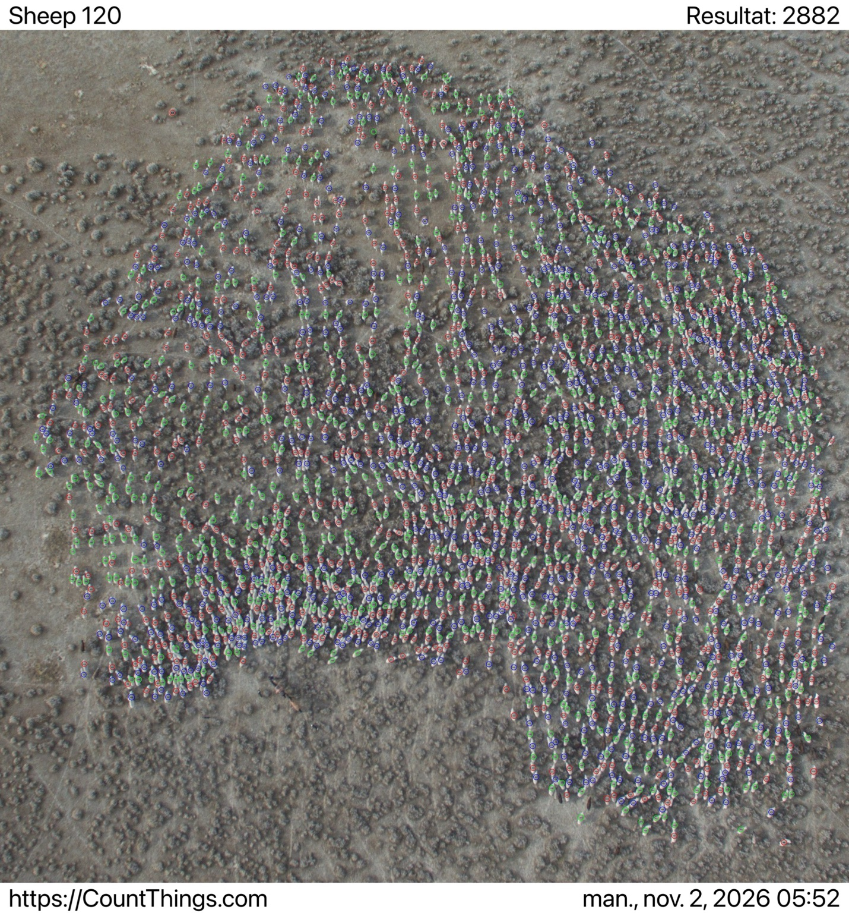

# Part 1 — sheep counting

## Results so far

| Method | Count | Status |
|---|---:|---|
| Initial LLM visual estimate | Approximately 2,500 | Rough, unverified estimate from the conversation |
| LLM-generated Python script | 3,621 | Executed on the supplied photograph; unvalidated heuristic |
| CountThings | 2,882 | User-supplied CountThings export; Sheep 120 template; unverified |

## Run the script

Install Python, then from this directory run:

```sh
python -m pip install -r requirements.txt
python count_sheep.py
```

No API key is needed. The script creates `results/summary.json`, `results/detections.csv`, `results/sensitivity.csv`, and `results/overlay.svg`. Open the SVG in a browser while keeping it in the results folder so the photograph resolves correctly. Coordinates use the original image size of 1942 × 1949 pixels.

## Method and limitations

The script detects locally bright regions, removes small regions, and suppresses nearby peaks. It is classical image processing, not a trained sheep-recognition model. The brightness and distance parameters were adjusted after an initial run visibly detected too many ground features. They were not calibrated against a known true count.

Visual inspection of the final overlay still shows false detections on terrain and possible missed or split sheep. Across nine parameter combinations, the counts ranged from 3,067 to 4,235. This is sensitivity to settings, not a confidence interval. The script count is reproducible but is not verified.

## Can I report this number to my audit partner?

You can report it as a preliminary AI estimate, clearly explaining its limitations. You should not present it as a verified livestock count or sufficient audit evidence. The sheep are small, closely grouped, and sometimes overlapping, so omissions and double counting are possible. The count needs independent validation, and the photograph's date, completeness, and connection to the farm must also be established.

## CountThings evidence and recommendation



The original user-supplied export is preserved unchanged. Its header shows the Sheep 120 template and a result of 2,882. Whether manual corrections were made has not been established.

I would report 2,882 to the audit partner as the provisional photo-based estimate, with low confidence in the exact number until the marked detections have been independently checked. CountThings provides detections that can be reviewed; the LLM estimate was rough, while inspection of the script overlay revealed false detections on terrain. This makes CountThings a provisional preference, not proof of superior accuracy.

The script exceeds CountThings by 739 (25.6% relative to CountThings); the initial LLM estimate is 382 lower (13.3%). These are differences between methods, not measured errors against a known true count. Verify missed sheep, duplicate detections, and false positives, and establish the photograph's date, completeness, and association with the farm before relying on it as audit evidence.

## Remaining steps

- Independently review detections and document any manual corrections.
- Complete the class results form linked in the original instructions. It has not been submitted.
