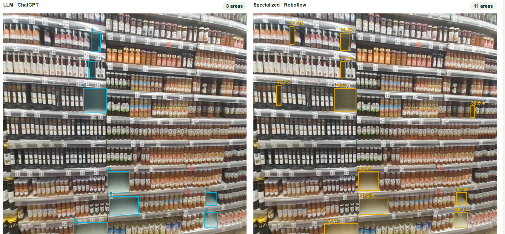

# Part 2 — empty shelf comparison

## Open the webpage locally

1. On GitHub, select **Code → Download ZIP** for the repository.
2. Extract the ZIP completely.
3. Open `Part 2 - shelves/comparison.html` in Chrome or Edge. All seven original photographs are embedded in the HTML; it also works when moved to another folder.

Alternatively, download just `comparison.html` using GitHub’s **Download raw file** button and open it. No installation, API key, server, or payment is required to view the saved comparison. GitHub's code view does not run HTML.

The page shows all seven images twice, with LLM boxes in cyan and specialized-model boxes in gold. Use the zone filter, overlay checkbox, and CSV download. The user-supplied local screenshot is saved as `results/comparison_screenshot.png`. It shows WA0017 with the original photograph and both overlays (8 LLM areas versus 11 specialized-model areas); the viewport cuts off the very bottom of the images.



## Results

Counts are contiguous detected empty shelf areas, not individual missing products. A gap may cover multiple product facings. The exact number of missing units cannot be established without shelf layout and stock information.

| Zone | Photo | LLM areas | Specialized areas |
|---|---|---:|---:|
| 1 | WA0009 | 1 | 1 |
| 1 | WA0010 | 1 | 1 |
| 1 | WA0011 | 1 | 1 |
| 2 | WA0012 | 7 | 10 |
| 2 | WA0014 | 12 | 17 |
| 3 | WA0017 | 8 | 11 |
| 3 | WA0019 | 5 | 6 |
| **Total** | | **35** | **47** |

`results/comparison.csv` contains the full filenames. Images show different views and may overlap, so totals describe detections across photographs, not unique store-wide gaps.

## How the results were obtained

**LLM:** ChatGPT inspected the original seven 640 × 640 images in this assignment conversation and generated approximate bounding boxes. The task applied is documented in `llm_prompt.md`. `prepare_detections.py` captures/replays these structured results into `results/llm_response.json`; it does not call a model. No paid LLM API was used. This analysis took place after specialized-model outputs were visible, so it is not a blinded comparison or an independent accuracy test.

**Specialized model:** The user uploaded each original image into Roboflow Universe's **Try This Model** for `empty-shelf-detection-r8cfz/1` and copied its JSON into this conversation. The saved `results/roboflow_browser.json` preserves the prediction coordinates, scores, class, and detection IDs. Only the surrounding filename labels and JSON formatting were normalized. All seven final records use the stated 25% confidence threshold and 50% overlap threshold. These settings were selected after exploratory testing of the first photo (0 areas at 50%, 4 at 9%, 1 at 25%), not by evaluation on a separate validation set.

Model: [Empty shelf detection by twar](https://universe.roboflow.com/twar/empty-shelf-detection-r8cfz), version 1, YOLOv11 object detector, CC BY 4.0. This existing model was used without retraining. Its published dataset metrics do not establish accuracy on these seven photos. Possible overlap between the supplied photos and model training data has not been ruled out; the Roboflow-style filenames alone cannot establish provenance.

## Code and reproducibility

Run from this folder with Python:

```sh
python prepare_detections.py
python build_comparison.py
```

These scripts need only the Python standard library. The first replays captured predictions; the second validates all seven records, converts Roboflow center/width/height boxes to corner coordinates, writes the comparison table, and builds the offline page. It does not fabricate zero detections on a failure.

`run_roboflow.py` is an **optional, unexecuted API rerun script** based on Roboflow's documented SDK. It uses an API key stored locally as an environment variable and saves outputs separately under `results/api_rerun/`. Check your account's available inference allowance before using it. Do not commit the key.

**Deliverable caveat:** The inference that produced the submitted results was performed interactively in ChatGPT and the Roboflow UI. The supplied capture/replay and webpage code were executed; the optional API inference script was not. A later Qwen programmatic run is documented below. Roboflow inference remains a browser run; if programmatic inference is required for both models, that portion remains unmet. Do not describe the API script as already executed.

## Recommendation

Show employees highlighted photo regions as replenishment alerts requiring confirmation, rather than exact missing-item quantities. On WA0009, both methods count one region but place it in different locations. The LLM highlights the central gap between milk cartons, while the specialized model marks a small lower-right region. On WA0011 the methods also highlight different shelf positions. These disagreements show why equal counts alone are insufficient.

For this small sample, the LLM locates several obvious gaps missed by the specialized model, while the specialized output also contains small and borderline regions. Neither is ground truth. Show reviewed alerts with the original photo and prioritize obvious large gaps. Validate both against independently annotated examples from these store zones before choosing a production system or claiming accuracy. Model confidence scores are not a measured probability that the restocking recommendation is correct.

## Submission checklist

- Counts table: `results/comparison.csv`.
- LLM result capture code and task: `prepare_detections.py`, `llm_prompt.md`, `results/llm_response.json`.
- Specialized-model output capture: `prepare_detections.py`, `results/roboflow_browser.json`; optional API code: `run_roboflow.py` (see caveat above).
- Comparison webpage: `comparison.html`; build code: `build_comparison.py` and `comparison_template.html`.
- Screenshot: `results/comparison_screenshot.png` (user-supplied evidence of the local page).
- Recommendation: above and on the webpage.

## Completed Qwen Colab run — separate experiment

The user returned the results ZIP from a real Qwen2.5-VL-3B-Instruct Colab run on 2 November 2026. Results are saved in [results/qwen_colab](results/qwen_colab/). Download [the new standalone comparison](results/qwen_colab/comparison_programmatic.html) using **Download raw file**, then open it locally.

| Photo | Qwen areas | Saved Roboflow areas |
|---|---:|---:|
| WA0009 | 1 | 1 |
| WA0010 | 1 | 1 |
| WA0011 | 1 | 1 |
| WA0012 | 1 | 10 |
| WA0014 | 2 | 17 |
| WA0017 | 1 | 11 |
| WA0019 | 1 | 6 |
| **Total** | **8** | **47** |

Qwen ran programmatically on all seven images. Roboflow was **not rerun**: the notebook reuses the unchanged detections obtained through the free browser demo. No paid API or API key was used for this completed run. The original ChatGPT comparison (35 versus 47) remains a separate experiment.

Checks: all seven original-image SHA-256 hashes match the run manifest; all raw Qwen responses reproduce the saved normalized boxes; all Roboflow records match the original browser results. Valid JSON and coordinates establish successful processing, not detection accuracy. Qwen coordinates are interpreted using the 0–1000 normalization requested in the saved prompt.

The source notebook is [Part_2_Programmatic_Inference.ipynb](Part_2_Programmatic_Inference.ipynb). It uses float32, eager attention, smaller image inputs and automatic CPU offloading after the initial float16 run produced unusable output. Its parser accepts flat/nested coordinate arrays and named coordinate fields without inventing missing boxes. Raw responses and the prompt are preserved.

**Recommendation for this run:** treat both outputs as candidate alerts requiring visual confirmation. Qwen reports only eight regions across the seven photographs, with substantial count disagreements in zones 2 and 3. This does not by itself establish either model's accuracy or which regions are true gaps. Inspect the original photos and both overlays before accepting alerts. Do not present the previous ChatGPT recommendation as a conclusion about Qwen.

**Remaining evidence:** a screenshot of the new Qwen comparison and the executed Colab notebook still need to be added. The ZIP includes an unexecuted source template; it is not the executed notebook. If the lecturer requires programmatic inference for both models, that requirement remains unmet for Roboflow: its inference was performed in the free browser UI.
