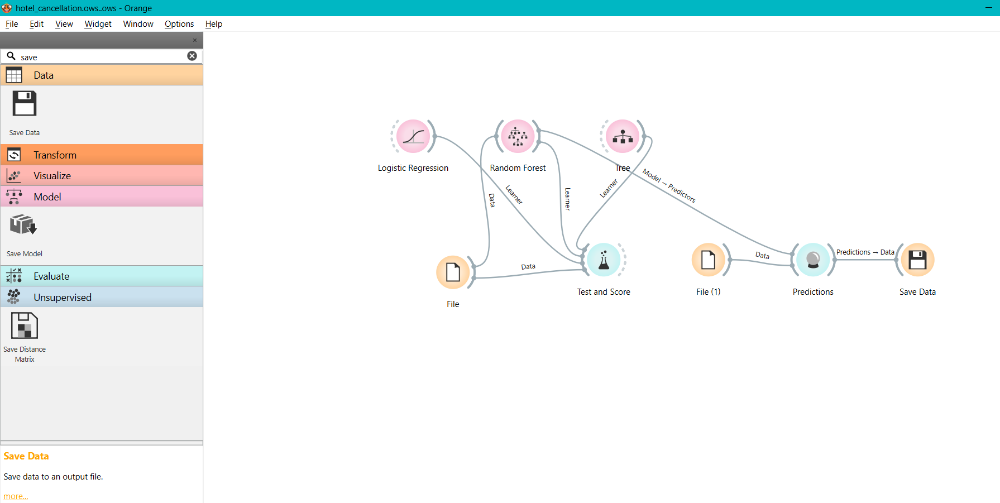
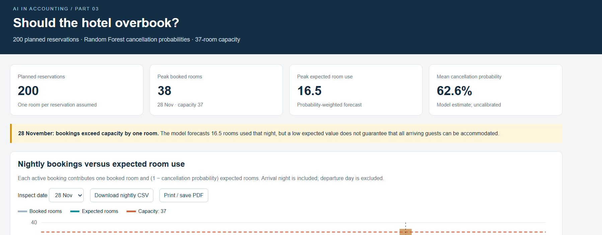
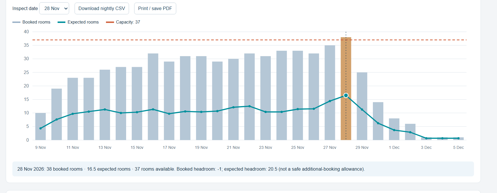

# Part 3 — should the hotel overbook?

## Open the dashboard

Download `dashboard.html` using GitHub's **Download raw file** button and open it in Chrome or Edge. It is self-contained and requires no server, installation, or API key.

The dashboard compares booked rooms, probability-weighted expected room use, and the hotel's 37-room capacity for every night from 9 November through 5 December 2026. Use the date selector or click a bar to inspect a night; a CSV download is available.

## Submitted predictions and model choice

`hotel_predictions.tab` is the unchanged user export from Orange. It has three Orange header rows and **200 reservation rows**. `hotel_predictions.csv` is a conventional 200-row file containing the original retained columns plus a stable ReservationID (original row number), arrival/departure dates, total nights, predicted class, CancellationProbability, and ShowProbability.

The exported reservation fields were checked against `planned_reservations.csv`: all 200 rows match in the original order. Class **1 means canceled**, and **0 means not canceled**. The Selected field is an Orange row-selection flag, not a cancellation outcome, and is excluded from the conventional CSV.

The user ran these models in Orange using **five-fold stratified cross-validation** on 4,000 historical reservations:

| Model | AUC | Accuracy | F1 | Precision | Recall | MCC |
|---|---:|---:|---:|---:|---:|---:|
| Logistic Regression | 0.823 | 0.740 | 0.734 | 0.737 | 0.740 | 0.447 |
| Random Forest | **0.871** | **0.795** | **0.793** | **0.793** | **0.795** | **0.568** |
| Tree | 0.767 | 0.749 | 0.748 | 0.748 | 0.749 | 0.475 |

Scores are transcribed at the precision displayed in the user's actual Orange screenshot. The class-specific dropdown was set to average over classes. The model comparison is in `results/model_comparison.csv`; the screenshot is `results/orange_test_and_score.png` if present.

**Choice:** Random Forest ranks first on all displayed measures. Its AUC of 0.871 indicates better discrimination than Logistic Regression (0.823) and Tree (0.767) on these cross-validation splits. It was then trained on all available historical records and used in Orange to produce the 200 future predictions. The dashboard code does not retrain or substitute another model. AUC and classification accuracy do not establish probability calibration.

## Data preparation in Orange

- Loaded the supplied historical CSV. Orange reported 4,000 instances and no missing feature values at import.
- Set `IsCanceled` to a categorical target (0/1).
- Skipped `ReservationStatus` and `ReservationStatusDate`, which reveal the final outcome.
- Skipped `AssignedRoomType`, which may only be determined after the intended prediction time.
- Loaded the 200 planned reservations in a separate File widget, skipping their blank `IsCanceled` column and the same three excluded columns.
- Trained the chosen Random Forest using historical data and connected its **Model** output to Predictions. Connected future data to Predictions, enabled class probabilities, and exported all Predictions (not just Selected Predictions).

The planned file contains Country, MarketSegment, Agent, and Company, which are absent from historical training data. They remain in the exported records for traceability but are not inputs to a model trained without them. Other dynamic fields, such as BookingChanges and special requests, must be interpreted as information available at the chosen forecasting time; the assignment does not establish an as-of snapshot for each historical booking.

## Results and recommendation

- Peak booked rooms: **38**, on **28 November 2026**, one above capacity.
- Expected room use on that night: **16.505874 rooms** (displayed as 16.5).
- Peak expected room use across the full period: **16.505874 rooms**.
- Total booked room-nights: **627**.
- Expected room-nights: **241.86091**.
- Mean predicted cancellation probability: **62.5759275%**.

The model suggests substantial spare capacity, but these are expected values rather than safe overbooking limits. Management should review the existing excess of one booked room on 28 November and have a contingency if all booked guests arrive. Before accepting additional overbookings, validate the probabilities, define an acceptable relocation risk, and consider compensation costs and bookings outside this supplied file.

The historical observed cancellation rate is 40.2%, lower than the future predictions' average of 62.6%. Different season and customer mix may contribute, but transfer from historical 2015–2016 observations to planned 2026 bookings has not been validated. Random historical cross-validation is not an out-of-time evaluation. The exact overcapacity probability and an optimal overbooking limit have not been established.

## Calculation and assumptions

For each night t:

- Booked rooms = number of reservations whose arrival date is on or before t and departure date is after t.
- Expected room use = sum of **1 − P(canceled)** over those reservations.
- Capacity = **37**.

Each reservation is assumed to use **one room** because no room-quantity column is supplied. This is an assumption, particularly for larger guest groups. The arrival night is counted and the departure date is excluded. Zero-night stays occupy no room-nights. No other hotel bookings or out-of-service rooms are included. Summing expected occupancy does not require cancellation independence, but calculating tail risk would require assumptions about dependence and reliable probabilities.

## Reproduce the dashboard

Run `python build_dashboard.py` from any directory. Only the Python standard library is required. The script reads the unchanged Orange export and planned input file, validates row alignment and probability sums, writes the clean prediction CSV and nightly table, reconciles booked/expected room-night totals, and generates the self-contained dashboard from `dashboard_template.html`.

`results/provenance.json` records source file hashes and assumptions. `results/nightly_room_use.csv` contains exact nightly calculations.

## Saved submission evidence

- Final Orange workflow saved: `hotel_cancellation.ows`. Original user file content preserved; only the duplicated filename extension was removed. The eight widget nodes and eight expected enabled links were checked in the XML. Opening elsewhere may require reselecting the local historical and planned data files.
- Final full Orange workflow screenshot saved: `results/orange_workflow.png`, showing training, model comparison, future input, Predictions, and Save Data.
- User-supplied local dashboard screenshots saved: `results/dashboard_summary.png` and `results/dashboard_chart.png`. The summary shows 200 reservations, peak booked rooms 38, peak expected rooms 16.5 and mean cancellation probability 62.6%. The chart shows booked rooms, expected rooms and the 37-room capacity; 28 November is selected.

The 200-row prediction file, model-choice explanation, saved workflow and workflow screenshot are prepared. Both screenshots of the dashboard open locally have now been supplied and saved.

